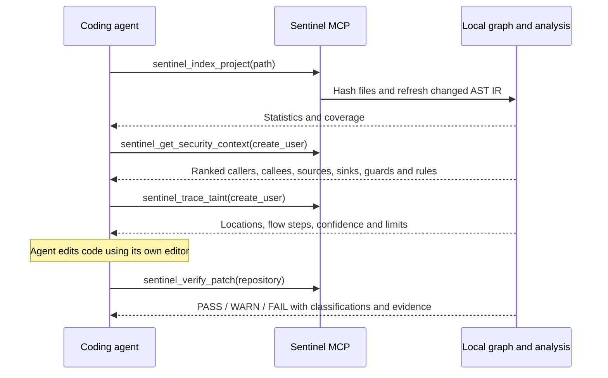

# Agent integration

Sentinel provides deterministic security evidence to coding agents over local
stdio MCP. No model, API key, external scanner, or network connection is needed
for its fifteen security tools. The agent remains responsible for editing code.

## Build and bind a repository

```sh
cargo build --release --bin sentinel
sentinel index /absolute/path/to/repository
sentinel mcp --repository /absolute/path/to/repository
```

Use the absolute executable path when configuring a client. On Windows, use
`C:/projects/Sentinal/target/release/sentinel.exe`; use an absolute path to the
repository being audited, which can differ from Sentinel's source repository.
Do not run the server manually alongside a client: the client starts its own
stdio process. stdout is JSON-RPC only; diagnostics use stderr. Closing stdin
shuts down the server. The official Rust SDK negotiates protocol versions.

## Codex

Add a local server in `~/.codex/config.toml`:

```toml
[mcp_servers.sentinel]
command = "C:/projects/Sentinal/target/release/sentinel.exe"
args = ["mcp", "--repository", "C:/projects/my-app"]
tool_timeout_sec = 120
```

Alternatively:

```sh
codex mcp add sentinel -- /absolute/path/to/sentinel mcp --repository /absolute/path/to/my-app
codex mcp list
```

Configuration shape and command syntax follow the
[official OpenAI documentation](https://learn.chatgpt.com/docs/extend/mcp?surface=cli).

## Claude Code

Register the native executable directly:

```sh
claude mcp add --transport stdio sentinel -- /absolute/path/to/sentinel mcp --repository /absolute/path/to/my-app
```

A project `.mcp.json` example:

```json
{
  "mcpServers": {
    "sentinel": {
      "type": "stdio",
      "command": "C:/projects/Sentinal/target/release/sentinel.exe",
      "args": ["mcp", "--repository", "C:/projects/my-app"]
    }
  }
}
```

See [Claude Code's MCP guide](https://code.claude.com/docs/en/mcp).

## Kilo CLI

Add this entry to your project `kilo.jsonc` (merge with existing settings):

```json
{
  "mcp": {
    "sentinel": {
      "type": "local",
      "command": ["C:/projects/Sentinal/target/release/sentinel.exe", "mcp", "--repository", "C:/projects/my-app"],
      "enabled": true,
      "timeout": 120000
    }
  }
}
```

This uses the current Kilo CLI configuration format, documented in
[Kilo's MCP guide](https://kilo.ai/docs/automate/mcp/using-in-kilo-code).

## OpenCode

Add this entry to project `opencode.json`:

```json
{
  "$schema": "https://opencode.ai/config.json",
  "mcp": {
    "sentinel": {
      "type": "local",
      "command": ["C:/projects/Sentinal/target/release/sentinel.exe", "mcp", "--repository", "C:/projects/my-app"],
      "enabled": true,
      "timeout": 120000
    }
  }
}
```

See [OpenCode's local MCP configuration](https://opencode.ai/docs/mcp-servers/).
These examples have been checked against client documentation; live registration
in all four clients has not been tested. The server itself has an end-to-end
stdio test covering discovery and every tool.

## Suggested coding-agent workflow



Use this instruction in your agent's project guidance:

> Before changing a security-sensitive function, retrieve Sentinel security
> context and inspect its sources, sinks, callers, sanitizers and guard evidence.
> Investigate relevant flows with trace_taint. After editing, call verify_patch.
> Cite rule IDs and file locations. Treat incomplete coverage and low confidence
> as review requirements; never claim a clean security result from them.

Example `tools/call` arguments:

```json
{"name":"sentinel_get_security_context","arguments":{"repository":".","target":"create_user","max_items":40}}
```

```json
{"name":"sentinel_trace_taint","arguments":{"repository":".","target":"create_user","sink_type":"sql-injection","max_call_depth":8,"max_paths":64,"max_nodes_visited":10000}}
```

```json
{"name":"sentinel_verify_patch","arguments":{"repository":".","base":"HEAD"}}
```

Targets accept symbol IDs, names, qualified names, repository-relative files,
in-repository absolute paths, and `file:line`. Context also accepts `diff`.
An omitted verification `base` uses a saved baseline when present, otherwise HEAD.
An explicit base always selects Git. Git comparisons require the configured root
to be the Git repository root. Saved-baseline verification can work without Git.

## Tool contracts

| Tool | Purpose |
| --- | --- |
| sentinel_index_project | Incremental index statistics, timings and coverage |
| sentinel_scan_file | Embedded rules plus cross-function taint; persist findings |
| sentinel_scan_diff | Compare changed files and transitive resolved call/reverse-import impact to HEAD/ref |
| sentinel_get_security_context | Ranked, bounded security evidence with reasons |
| sentinel_trace_taint | Potential source-to-sink paths, confidence and limits |
| sentinel_explain_finding | Deterministic WHAT/WHERE/WHY/FLOW/EVIDENCE/FIX for a persisted ID |
| sentinel_verify_patch | Verdict, new/resolved/unchanged/regressed findings and flows |
| sentinel_find_symbol | Search names, IDs, files and locations |
| sentinel_get_callers | Incoming calls and caller symbols |
| sentinel_get_callees | Outgoing calls; unresolved dynamic names remain explicit |
| sentinel_get_audit_workflow | Bundled audit adapter, upstream revision and validation contract |
| sentinel_get_audit_status | Retained audit records, coverage gaps and source freshness |
| sentinel_get_audit_history | Bounded retained revision metadata; historical source freshness is not inferred |
| sentinel_get_audit_revision | One retained imported run by revision_id; freshness unchecked and execution unobserved |
| sentinel_get_audit_artifacts | Normalized JSON descriptors by revision_id; original artifact paths are never opened |

Context includes freshly derived graph-flow findings alongside existing stored
occurrences. For explain_finding, first persist the occurrence through scan_file
or audit.
Historical findings remain explainable when their current source is unavailable.
Structured results appear in `structuredContent` and mirrored JSON text. Tool
failures set `isError` and return an error object. No tool accepts a shell command.
Indexing and scans write only the local SQLite store; verification updates saved
baseline lifecycle metadata after complete analysis. No security tool changes
repository source, checks out Git commits, or calls an LLM.

## Limits and interpretation

`max_items` is 1-200; targets are capped at 512 bytes. Trace limits are call depth
1-32, paths 1-200, nodes 1-100000 (defaults 8/64/10000). Origin joins retain 32
unique source/sanitizer states and diagnose overflow. MCP results are capped at
4 MiB; narrow the target when the server reports an oversized response.

Context scores prioritize exact targets, source/sink evidence, related findings,
applicable rules, and direct call neighbors. Each selected item gives reasons;
omitted_count describes retrieval truncation. Applicability is not a rule hit.
Guard annotations are syntactic evidence, not a proof of authorization dominance.
Dynamic calls, complex aliases, closures, exceptions, and framework-specific
semantics can require review. Inspect coverage_notes and complete before using
any verdict as a gate. Optional Ollama/NIM explanations are CLI/TUI features;
they never create or overrule deterministic MCP findings.

Symbol lookup and caller/callee responses include `index_complete` and
`coverage_notes` from the refreshed graph. Check these alongside `omitted_count`:
a valid target can still have an incomplete repository index because another
source file failed analysis. `index_complete: true` does not imply an untruncated
answer, compiler-level soundness or that unresolved calls are safe. Older typed
responses missing the flag deserialize conservatively with completeness false.

Navigation queries also carry `backend` (native version and semantics revision)
and `source_snapshot`, using the same sorted indexed path/hash identity as taint
traces. Compare identities before combining retained answers. The hash covers
indexed files, not excluded/unreadable repository content or an atomic live
filesystem snapshot. Pagination and target choice do not change this identity;
source refresh can. Older responses retain unknown (`null`) provenance.

A stored graph snapshot reads files, edges and index statistics within one SQLite
transaction, so another connection's refresh cannot splice different commits
into one answer. Snapshot reads join a caller's existing transaction without
committing or rolling it back; otherwise Sentinel owns and releases the read
transaction, including on parse failure. This database consistency does not make
source indexing an atomic live-filesystem observation.

Graph refresh reserves the SQLite writer with an immediate transaction before
loading reusable IR, then keeps that reservation through reconciliation and
commit. Concurrent refreshes cannot apply deltas calculated from a superseded
stored graph. Any failure rolls back all graph changes and releases the owned
transaction. Other writers (including job cancellation) can wait up to the
configured five-second SQLite busy timeout, then receive an error; this is a
correctness tradeoff, not a scalable refresh or responsive cancellation guarantee.
Reads can continue under SQLite's normal locking rules. The reservation does not
freeze source files, and filesystem mutations still require later reconciliation.


Native graph indexing, baseline assessment, current Git diff evidence and finding
source excerpts share a source reader that caps actual bytes at 1 MiB plus one
byte for overflow detection before UTF-8 decoding. Oversized or invalid text
makes required analysis incomplete and cannot create a baseline or trusted PASS.
The excerpt path retains its existing empty-excerpt behavior on read failure.
This cap holds even if a regular source file grows after metadata inspection;
it does not freeze files, prevent path replacement races, bound all process memory,
or enforce a hard read deadline.


Saved baselines are limited to 16 MiB of serialized UTF-8 JSON. Creation rejects
larger records before replacing accepted debt; reads transfer at most the limit
plus one overflow byte before parsing. Invalid stored baseline contracts fail
before current-source assessment or debt lifecycle updates, with no implicit Git
fallback. Finding/key counts, supplied snapshot hashes and modern evidence
identities must agree. Legacy baselines without typed provenance remain readable
and return WARN. These checks detect inconsistency, not deliberate authenticated
storage tampering. The limit does not bound all SQLite or serialization memory.


Finding explanations carry the native backend, indexed source snapshot identity
and index completeness alongside a separately hashed current source excerpt.
`excerpt_matches_graph` reports whether the source bytes used for the excerpt
match that file's indexed hash. A missing, unindexed or differing excerpt adds a
coverage note: symbols/flows still describe the indexed view. Historical finding
validity requires a fresh scan or verification even when this flag is true.
Older typed responses default missing identities to null and completeness/match
flags to false. This metadata detects view disagreement; it does not authenticate
storage, establish full scope or make filesystem observation atomic.


Ranked security context also includes the native backend and indexed source
snapshot identity used by traces and graph navigation. Target selection and
response limits do not change that identity; an indexed-source change does.
Completeness and omitted counts remain independent of identity. It covers the
admitted graph manifest, not historical finding validity, independently read Git
state, excluded source or atomic filesystem observation. Historical findings keep
their scan-history warning. Older typed context responses retain null provenance.


Native refresh cleanup uses SQLite indexes on project/file for symbols and security
annotations. These additive indexes are installed for new and existing schema-v7
databases without changing payload formats or semantic revision. Newly admitted
files skip deletion of nonexistent prior graph records; changed/deleted files keep
transactional cleanup. This reduces avoidable lookup work but does not remove full
source reconciliation, edge rebuilding, writer reservations or the 2000-file cap.


Index statistics include optional millisecond stage timings: source refresh
(writer reservation, previous IR load, enumeration, reads and parsing), relationship
analysis (resolution, bounded tracing and summary counts), and persistence (graph
row writes). `duration_ms` now includes those graph writes; earlier versions
reported it before persistence. Metadata-row writing and transaction commit remain
outside these stored timers, so use CLI wall time for end-to-end comparisons.
Legacy statistics decode missing timings as null, rather than fabricated zeros.
These are coarse diagnostics, not per-operation profiling or latency guarantees.


Source-refresh diagnostics separately accumulate `source_read_ms` (batch wall time
for checked paths, capped UTF-8 reads and worker launch/join) and
`source_extract_ms` (serial AST/security extraction for changed or new files).
Durations accumulate before millisecond conversion so small operations are not
individually rounded away. These are subsets of source
refresh; loading, enumeration, hashing and bookkeeping remain residual costs.
Unchanged files have a measured zero extraction duration. Older stage records
without these counters retain null values rather than invented measurements.


Native index refresh reads source in ordered batches of at most four scoped
workers. Workers share only the canonical repository root and entry paths; SQLite,
IR reuse, byte admission, parsing, coverage notes and persistence remain on the
calling thread. All reads retain the per-file cap and scope checks. Results are
consumed in lexical order. Near the 16 MiB admitted-source limit, batches shrink
to one file, retaining the previous single-file overflow ceiling and scope.
Single-file batches use a direct read. Workers are joined before processing the
next batch; no background read is detached. This bounds concurrently retained
source lengths, not allocation capacity, thread stacks or overall process memory.
Blocked filesystem reads can still delay joining/cancellation: this is not a hard
worker deadline, atomic filesystem snapshot or independently reviewed containment.
Multiple concurrent index calls each have their own four-worker bound.


Graph edge persistence prepares its fixed insert statement once per refresh and
binds each edge through that statement. Full edge replacement and transactional
rollback remain unchanged; the statement is released before metadata/commit.
This removes repeated SQL preparation, but does not provide incremental edge
updates, reduce admitted scope or establish end-to-end latency guarantees.


Git read helpers require subprocess exit code zero before accepting stdout.
The shared process runner exposes the actual optional exit code while preserving
Semgrep/Bandit exit-one finding semantics. Git cannot inherit that scanner-specific
success convention: nonzero read output is rejected, not interpreted as a complete
source blob or changed-file list. Existing output/deadline and no-external-diff/
no-textconv/fsmonitor protections remain in effect.


Security context targeting `diff` now treats unavailable Git selection, changed
paths outside the current graph and deleted paths without current symbols as
partial scope. Known empty Git changes remain distinguishable from unavailable
selection. Deleted/unindexed changed paths remain visible as change metadata,
with notes directing before/after questions to `scan_diff`. At most 200 change
metadata candidates are admitted, and omitted counts include the remainder plus
normal response truncation. Named symbol/file context keeps Git metadata optional.
Graph snapshot identity still covers indexed files; it does not identify Git state.


Ranked context accumulates candidates in a keyed BTreeMap before final score/key
sorting. Repeated evidence keys retain the first evidence value, maximum relevance
and distinct reasons in traversal order. Lookup no longer linearly searches every
previous candidate for each insertion. Ranking, source identity, output limits and
omission accounting remain unchanged. This reduces candidate lookup complexity;
it does not bound all graph work/memory or establish end-to-end latency.


Security context reports `omitted_target_symbols` separately from ranked-item
`omitted_count`. Both the target-symbol array and selected-item array use max_items,
so a file with many definitions can omit targets as well as ranked evidence.
The new optional counter is a known number for current responses and null for
legacy responses that never recorded it. Completeness remains analysis/scope
completeness, not a promise that either response array is exhaustive. Target and
output limits do not alter the indexed source identity.

Shell clients can retrieve this same static context directly:

```sh
sentinel context create_user --project /path/to/repository --max-items 40
```

The command refreshes the graph, prints JSON and uses exit 0 for complete scope
or 2 for partial scope/errors. Partial results still carry valid JSON; an error
can have no JSON output. Targets include symbols, relative files, `file:line`
and `diff`. Limits accept 1..200; omissions are separate from completeness.
This path does not contact a provider or execute target code. It retains full
source reconciliation and the existing index admission limits.

During index refresh, taint-path edge construction uses a keyed source/sink
annotation lookup by kind, owner and start line. Repeated lookups no longer scan
all annotations for each path endpoint. The first annotation for a shared key is
retained, and missing annotations still fall back to the symbol identity. This
preserves the existing line-based endpoint contract; it does not add column or
category disambiguation, semantic coverage, incremental refresh or a measured
end-to-end latency guarantee.

The existing symbol/call tools also have shell JSON equivalents for investigation
and fixed query-corpus runners:

```sh
sentinel symbols create_user --project /path/to/repository --max-items 40
sentinel callers create_user --project /path/to/repository --max-items 40
sentinel callees create_user --project /path/to/repository --max-items 40
```

They reuse `sentinel_find_symbol`, `sentinel_get_callers` and
`sentinel_get_callees` engine contracts. Symbol search accepts names, IDs, files
and `file:line`; call queries select targets by the same rules and return direct
edges. Unresolved outgoing edges remain explicit and may have no neighbor symbol.
Each command refreshes the graph and returns backend/source identity,
index_complete, coverage notes and omission counts. Exit 2 identifies a partial
index or error, not response truncation alone. The limit is 1..200. These commands
add no arbitrary SQL, executable graph query, target execution or provider request.

Import resolution computes each source file's unique module target once per
relationship refresh and reuses that decision for IMPORTS edges and calls through
that import. A second matching module makes the import unresolved; new refreshes
recompute the decision from the entire current indexed scope. This removes
repeated file-wide module-count searches for every matching call. Symbol lookup,
full source reconciliation and ambiguity/unsupported semantics remain unchanged;
no overall latency, memory or incremental-update guarantee follows.

Relationship refresh also groups imported symbol candidates by short name and
indexes call owners by symbol ID. Name groups retain all candidates in original
traversal order; ambiguity is still unresolved, and duplicate IDs retain the
previous first-owner behavior. This replaces full-project name/owner scans for
individual calls with lookups inside one immutable refresh. Same-file lexical
scope searches, full hashing/relationship recomputation and admission limits
remain. Extra borrowed-reference lookup storage does not establish an overall
memory or latency bound.

Context dependency retrieval joins IMPORTS endpoints through indexed file identity,
not module-symbol identity: those are separate graph keys. Uniquely resolved
imports now admit dependency symbols even without a direct call. Imports from
selected target files also remain visible as relationship evidence, including
unresolved ambiguity. Ambiguous modules contribute no guessed dependency symbols.
Existing ranking scores/reasons, response limits, omissions and indexed-source
identity remain in effect; static import evidence does not prove runtime dispatch.

Static path tracing is available over the CLI through the existing trace engine:

```sh
sentinel trace handler --project /path/to/repository --sink sql-injection
sentinel trace . --project /path/to/repository --max-call-depth 8 --max-paths 64 --max-nodes-visited 10000
```

The target supports symbols, relative files/locations and `.` for the whole
indexed scope. Optional sink filtering uses exact category strings. Budgets are
call depth 1..32, paths 1..200 and visited nodes 1..100000; defaults match MCP's
native TraceLimits. Budgets apply to project traversal before target/sink
filtering, so unrelated scope can also cause a conservative partial result.
Complete traversal exits 0; incomplete/exhausted traversal exits 2 with JSON
coverage diagnostics. Request errors can exit 2 without JSON. Output includes
backend/source identity, paths and confidence. Empty paths after filtering and
complete traversal are not verification PASS or confirmed security claims.
The command refreshes the graph, executes no target code and calls no provider.

Stored finding retrieval (`list_findings`, individual explanation lookup and legacy
finding migration) bounds each of the ten finding text fields to 1 MiB plus a byte
overflow sentinel in SQLite, then rejects aggregate text above 1 MiB before owned
string allocation or JSON decoding. Numeric columns reject stored nonnumeric values
in SQL. Valid empty strings and exact-limit payloads remain readable. Oversized
records fail the whole request with a size-only error; they are never truncated
into apparently complete evidence, silently skipped or rewritten. Context and
explanation propagate the error. Legacy migration rolls back on rejection.

This is a finding-row read boundary, not a total process memory/deadline guarantee.
General finding list row counts and extra legacy lifecycle metadata
retain their existing limits (or lack thereof). Ranked context now retrieves only
active findings from files in its scored graph neighborhood, using separator-normalized
exact path matching and bound SQL parameters. This includes caller/callee and import
neighborhood files, not just the directly selected file. It admits at most 200 stored
findings; a 201st match fails the request with a row-limit error rather than silently
truncating history or guessing an omitted count. This cap is independent of max_items.
An unrelated malformed/oversized finding cannot block context for another neighborhood;
a matching malformed/oversized finding still fails the request. Resolved history
is excluded. The database API accepts at most 2000 file paths and a row limit of
1–200, with empty file scope returning no records. SQLite uses a file/active-state
index added on normal writable schema-v7 opens; no payload rewrite or
analysis-semantics change is needed. This is scoped bounded
retrieval, not pagination or a hard bound on query work, total memory or latency.

Finding insertion and upsert now enforce the same aggregate 1 MiB text budget as
reads. Scalar text is charged in UTF-8 bytes, then execution_path, affected_components
and evidence are encoded sequentially into bounded standard-library slice writers.
JSON quoting, control-character escaping, delimiters and multibyte text count against
the shared remaining budget. No oversized finding reaches the INSERT/UPDATE or
fingerprint calculation, and an invalid upsert cannot reactivate a resolved record.
Scan persistence retains its existing transaction: failure in a later finding rolls
back earlier findings, scan metadata and scan snapshots, preserving old lifecycle
state. Valid exact-limit payloads remain readable. This bounds finding admission
and its JSON-array encoding, not already allocated caller inputs, full-report
metadata/snapshot serialization or total worker memory/deadline consumption.

Finding numeric admission and retrieval share a contract: confidence is finite in
[0, 1], and a source line is positive and representable by both SQLite's signed
64-bit integer and the host usize. Writes validate before JSON encoding, fingerprinting
or SQL mutation. Reads validate before finding JSON decoding. Invalid stored lines
are rejected rather than clamped to line 1, and non-finite/out-of-range confidence
cannot be returned as valid numeric confidence. Legacy migration fails
and rolls back on invalid numeric history instead of rewriting it. Scan persistence
also rolls back if a later finding violates this contract. Errors omit stored
values; validation does not establish source freshness or confirm a finding.

Scan persistence admits identifiers up to 128 UTF-8 bytes and a combined 1 MiB
metadata budget for id, target path, outcome, encoded coverage notes and encoded
scanner results. File/symbol counts and elapsed milliseconds must fit nonnegative
SQLite i64 values. Metadata validation/encoding occurs before starting the write
transaction. Historical finding snapshots use the same bounded slice encoder,
with an 8 MiB individual and 16 MiB aggregate encoded-byte cap per scan. The
aggregate is charged for actual encoded bytes, including escaping; it is separate
from each finding row's 1 MiB admission budget. Overflow after earlier rows or
snapshots have been inserted rolls back the entire scan before lifecycle updates.
Errors report the budget failure without payload contents. These are new-write
admission limits, not retrospective validation of legacy scan metadata, physical
SQLite/WAL limits, caller-input limits or independently reviewed worker containment.

Complete-scan occurrence resolution reads prior active id/file metadata in 64-row
keyset batches inside the existing scan transaction. Each read finishes before
updates begin; the next batch advances by rowid values unchanged by these updates, so resolving
rows cannot cause OFFSET-style skips. The first query has no lower sentinel and
includes negative/minimum/zero rowids. New current-scan findings remain excluded.
The existing scope rules still resolve admitted scanned files and missing paths
inside a full-scan target, leaving unselected existing files and outside paths
active. Id/file projections and their aggregate text use the finding 1 MiB read
boundary. Invalid later metadata rolls back earlier batches and new scan writes.
This bounds the candidate list, while total work, filesystem-stat latency,
transaction journal size and worker deadlines retain their existing limitations.
General history listing/pagination remains separate outstanding work.

Persisted index statistics use the database's bounded typed metadata API: at most
1 MiB of encoded JSON per project. Writes reuse the bounded slice encoder before
upsert and join the caller's transaction without committing it. Reads request at
most 1 MiB plus one overflow byte as a SQLite BLOB slice, reject overflow before
JSON decoding, and deserialize the expected type. Missing rows return None;
malformed, empty or oversized rows fail instead of becoming absent/default complete
metadata. Engine.status and snapshot also require the payload's project ID and
repository path to match the opened engine, rejecting even parseable complete
statistics for a different identity. Errors omit the stored identity values and
preserve caller transaction ownership. This check is not source-freshness or
tamper-proof evidence. Snapshots still pin their existing read transaction across
files, edges and statistics. Native index refresh
recomputes valid statistics and can replace corrupt retained metadata after source
reconciliation. Read failures alone never alter stored bytes. This is a statistics
payload boundary; cached file IR/edge payloads, total snapshot size and hard worker
resource limits remain separate work.

Cached file loads compare the decoded IR's path, language and content hash against
the selected file row before returning it. Both native refresh and stored snapshot
reads use this shared boundary. A contradiction fails explicitly, omits stored
values from the error and preserves retained rows; refresh's writer transaction
rolls back, and snapshots retain caller transaction ownership. Unlike statistics,
contradictory file IR is not automatically rebuilt. Explicit recovery is available
with `sentinel index /absolute/project --rebuild` or Engine.rebuild_index. It clears
only that project's files, symbols, security annotations, symbol edges and index
statistics within the same immediate writer transaction as source reconciliation
and replacement. It bypasses decoding the discarded cache. Findings, scan snapshots,
baselines, jobs, audits/artifacts, memory and other project rows are preserved.
Errors roll back cache removal and new writes together. Partial source analysis
retains the usual incomplete coverage and CLI exit 2; it is not a security PASS.
Successfully indexed files count as changed, with no reused/removed-cache counts. Ordinary
indexing remains incremental; MCP/TUI do not request rebuild implicitly. This
consistency check does not authenticate a database author who changes
both representations together, validate every nested IR record, or bound payload
sizes and total cache memory. Normal source-hash reconciliation remains necessary.

Stored snapshot edges also require their decoded endpoints, kind, file, line,
name and resolved flag to match the selected SQLite row. Negative/unrepresentable
line values and noncanonical stored booleans cannot be silently cast into valid
edge metadata. Contradictions fail with a fixed message before the snapshot is
returned. Read failures preserve stored rows and caller transaction ownership.
Ordinary index refresh rebuilds edges from file IR and can replace contradictory
edge rows; explicit rebuild is available when the file cache itself is unusable.
These checks do not authenticate graph authorship, validate semantic reachability
or impose edge-payload/whole-cache memory budgets.
